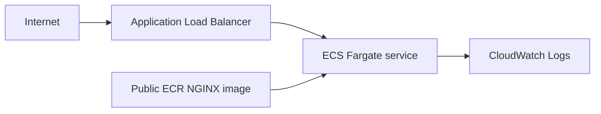

# Terraform Boundaries Reference

A small AWS reference showing that valid Terraform is not the same thing as well-structured infrastructure.

> **Terraform can describe infrastructure. It cannot decide where your boundaries should be.**

This repository evolves the same workload through three stages:

```text
01-works
   ↓
02-abstraction-trap
   ↓
03-bounded
```

## Current stage

```text
02-abstraction-trap
```

Stage 01 proved that the deliberately flat configuration could deploy a working workload and converge to:

```text
No changes.
```

Stage 02 now performs a plausible cleanup:

> Put infrastructure into modules.

The catch is that the module boundaries mostly follow AWS resource categories rather than architectural responsibilities.

The result looks more organized. The question is whether it actually became easier to reason about.

## Runtime architecture



The runtime architecture is intentionally unchanged.

## Stage 02 structure

```text
infra/
├── main.tf
├── moved.tf
├── modules/
│   ├── vpc/
│   ├── subnets/
│   ├── routing/
│   ├── security-groups/
│   ├── log-group/
│   ├── iam-role/
│   ├── load-balancer/
│   ├── ecs-cluster/
│   ├── task-definition/
│   └── ecs-service/
└── ...
```

At first glance this is cleaner than stage 01.

The root module is shorter. Individual files are smaller. Resources are hidden behind names.

But the coupling did not disappear.

It moved into module inputs, outputs and dependency wiring.

## Refactoring without replacement

Stage 02 uses Terraform `moved` blocks to transfer existing objects from their stage 01 root addresses into child-module addresses.

The intended plan should show address moves without destroying and recreating the workload.

After applying those state moves, the infrastructure should again converge to:

```text
No changes.
```

## Comparison

| Stage | Works? | Terraform valid? | Structure | Main tension |
| --- | --- | --- | --- | --- |
| `stage/01-works` | yes | yes | one root module | too much shared context |
| `stage/02-abstraction-trap` | yes | yes | resource-shaped modules | indirection without ownership |
| `main` (`03-bounded`) | planned | planned | responsibility-oriented boundaries | explicit ownership and dependency direction |

## Stage 02 verification

```bash
make init
make check
make plan
```

Review the plan carefully. We want:

```text
0 to add, 0 to change, 0 to destroy
```

plus resource-address moves.

Then:

```bash
make apply
curl "$(terraform -chdir=infra output -raw alb_url)"
make plan
```

The final plan should again say:

```text
No changes.
```

Then preserve this version:

```bash
git branch stage/02-abstraction-trap
git push origin stage/02-abstraction-trap
```

## Documentation

- [`docs/evolution.md`](docs/evolution.md)
- [`docs/decisions.md`](docs/decisions.md)

---

Built by [KrystalIT](https://krystalit.pl).

**Terraform does not organize chaos. It can only describe it very precisely.**
