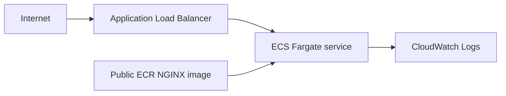

# Terraform Boundaries Reference

A small AWS reference showing that valid Terraform is not the same thing as
well-structured infrastructure.

> **Terraform can describe infrastructure. It cannot decide where your
> boundaries should be.**

This repository deliberately evolves the same workload through three stages:

```text
01-works
   ↓
02-abstraction-trap
   ↓
03-bounded
```

All stages are intended to describe the same application behavior.

The experiment is not about whether Terraform can produce a valid plan.

It is about what happens to understanding when structure changes.

## Current stage

This initial version implements:

```text
01-works
```

The infrastructure is intentionally kept in one root module and most resources
live in one `main.tf`.

It is not broken.

That is the point.

The next stage will try to "clean it up" with resource-shaped modules and show
how abstraction can increase indirection without creating useful boundaries.

The final stage will reorganize around responsibilities and lifecycle rather
than around AWS resource types.

## Architecture



The workload is deliberately boring.

That keeps the focus on Terraform structure rather than application code.

## What stage 01 proves

Stage 01 should be able to:

```text
terraform init
terraform validate
terraform plan
terraform apply
curl <alb_dns_name>
terraform destroy
```

A successful deployment does **not** prove the Terraform is well structured.

It only proves that the infrastructure can be created.

## Planned comparison

| Stage | Works? | Terraform valid? | Structure | Main tension |
| --- | --- | --- | --- | --- |
| `stage/01-works` | yes | yes | one root module | too much shared context |
| `stage/02-abstraction-trap` | yes | yes | many resource-shaped modules | indirection without ownership |
| `main` (`03-bounded`) | yes | yes | responsibility-oriented structure | explicit boundaries |

The final repository will make these versions directly comparable.

## Cost model

This reference intentionally avoids:

- NAT Gateway,
- RDS,
- EKS,
- private service endpoints,
- custom container registry,
- multiple ECS services.

Fargate tasks receive public IPs so they can pull the public container image
without a NAT Gateway. Inbound traffic to tasks is still restricted to the ALB
security group.

This is a cost-conscious reference choice, not a universal production pattern.

## Requirements

- Terraform `>= 1.9`
- AWS credentials
- GNU Make
- an AWS account where you can create VPC, ALB, ECS, IAM and CloudWatch
  resources

Default region:

```text
eu-central-1
```

## Usage

Initialize:

```bash
make init
```

Format and validate:

```bash
make check
```

Review:

```bash
make plan
```

Deploy:

```bash
make apply
```

After apply:

```bash
terraform -chdir=infra output -raw alb_url
```

Open that URL or use `curl`.

When finished:

```bash
make destroy-plan
make destroy
```

## Branch strategy

After stage 01 has been deployed and verified, preserve it:

```bash
git branch stage/01-works
git push origin stage/01-works
```

Then continue development on `main`.

After the abstraction-trap version is verified, preserve that commit as:

```bash
git branch stage/02-abstraction-trap
git push origin stage/02-abstraction-trap
```

`main` will eventually contain the final `03-bounded` version.

This produces three directly browsable versions of the same infrastructure.

## Documentation

- [`docs/architecture.md`](docs/architecture.md)
- [`docs/evolution.md`](docs/evolution.md)
- [`docs/decisions.md`](docs/decisions.md)

---

Built by [KrystalIT](https://krystalit.pl).

**Terraform does not organize chaos. It can only describe it very precisely.**
