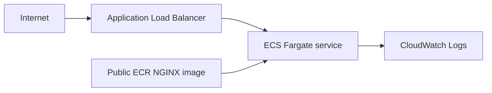
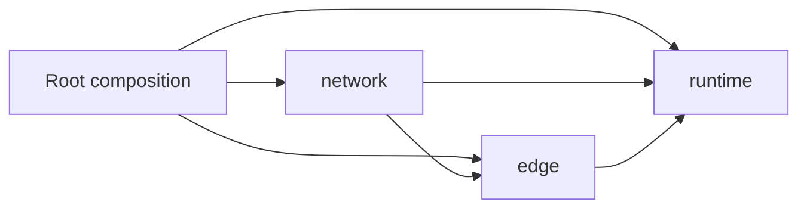

# Terraform Boundaries Reference

A small AWS reference showing that valid Terraform is not the same thing as well-structured infrastructure.

> **Terraform can describe infrastructure. It cannot decide where your boundaries should be.**

This repository evolves the same workload through three stages:

```text
01-works
   ↓
02-abstraction-trap
   ↓
03-bounded
```

All three stages describe the same runtime behavior.

The experiment is not about whether Terraform can produce a valid plan.

It is about how much context a human needs when the system changes.

## Final stage

```text
03-bounded
```

Stage 01 worked with one root module.

Stage 02 introduced ten resource-shaped modules.

Stage 03 keeps modules, but only where they represent a meaningful responsibility and lifecycle boundary.

The final structure has three boundaries:

```text
network
edge
runtime
```

## Runtime architecture



The runtime architecture is unchanged from stages 01 and 02.

## Terraform architecture



### `network`

Owns infrastructure whose lifecycle is primarily network topology:

- VPC
- internet gateway
- public subnets
- public route table
- route table associations

### `edge`

Owns the public entry point:

- ALB security group
- Application Load Balancer
- target group
- listener

### `runtime`

Owns the workload lifecycle:

- ECS security group
- ECS cluster
- task execution IAM role
- task definition
- ECS service
- CloudWatch log group

Identity and logging intentionally live with the runtime instead of becoming separate modules merely because AWS exposes them as separate services.

## Why this is different from stage 02

Stage 02 asked:

```text
What AWS resource category is this?
```

Stage 03 asks:

```text
What responsibility owns this?
What changes together?
What does this component need to know about the rest of the system?
```

That reduces ten module boundaries to three without returning to one giant root module.

The point is not that three is a magic number.

The point is that each boundary now has a reason to exist.

## Comparison

| Stage | Works? | Terraform valid? | Custom modules | Organizing principle |
| --- | --- | --- | ---: | --- |
| `stage/01-works` | yes | yes | 0 | everything together |
| `stage/02-abstraction-trap` | yes | yes | 10 | AWS resource categories |
| `main` (`03-bounded`) | yes | yes | 3 | responsibility + lifecycle |

All three versions can produce a valid plan.

Only the structure changes.

## Refactoring without replacement

Stage 03 uses Terraform `moved` blocks again.

Existing objects move from the ten stage 02 child modules into the three stage 03 responsibility-oriented modules.

The intended migration plan is:

```text
0 to add, 0 to change, 0 to destroy
```

with address moves only.

## Verification

```bash
make init
make fmt
make check
make plan
```

If the plan contains only moved addresses:

```bash
make apply
curl "$(terraform -chdir=infra output -raw alb_url)"
make plan
```

The final plan should return:

```text
No changes.
```

## The point

Terraform can tell us whether configuration and infrastructure agree.

It cannot tell us whether the configuration is easy to understand.

It can validate syntax, construct a dependency graph and calculate a plan.

It cannot decide whether `iam-role` deserves to be a module.

That part still belongs to architecture.

---

Built by [KrystalIT](https://krystalit.pl).

**Terraform does not organize chaos. It can only describe it very precisely.**
